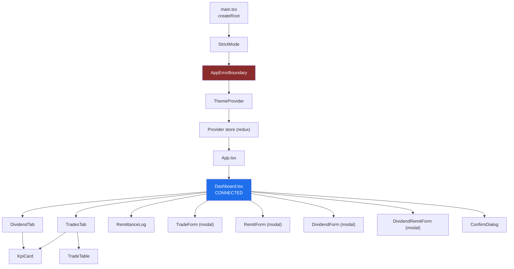
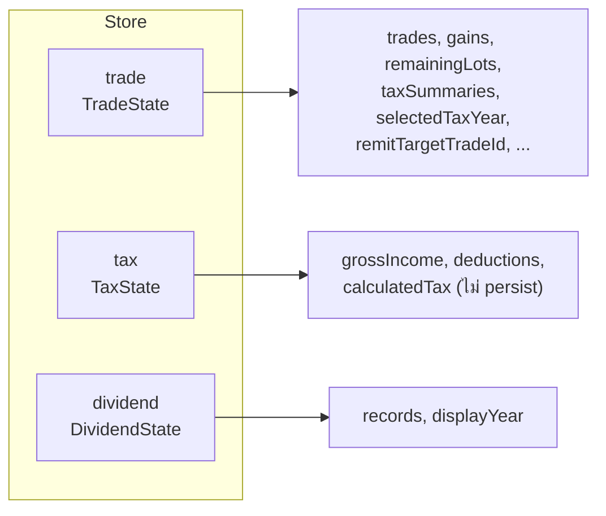
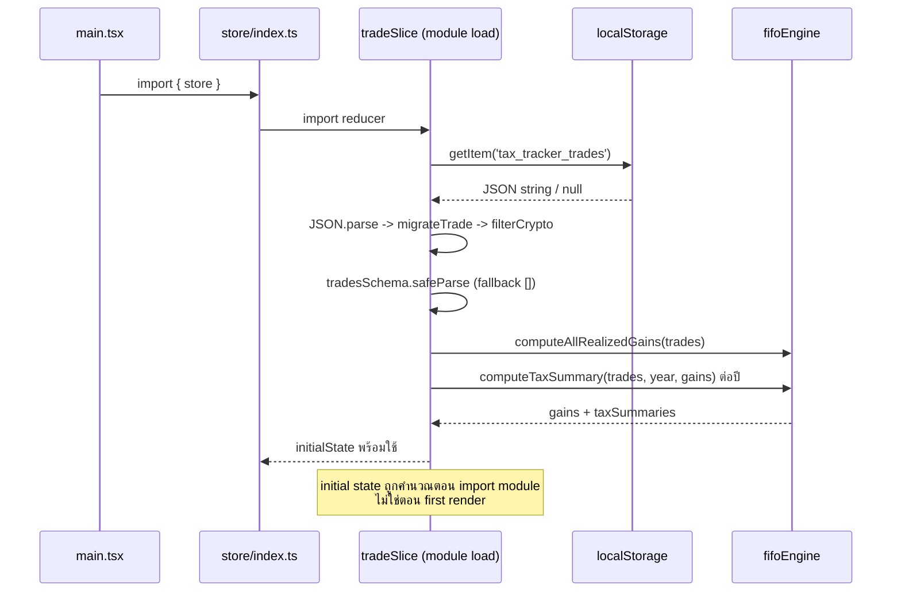
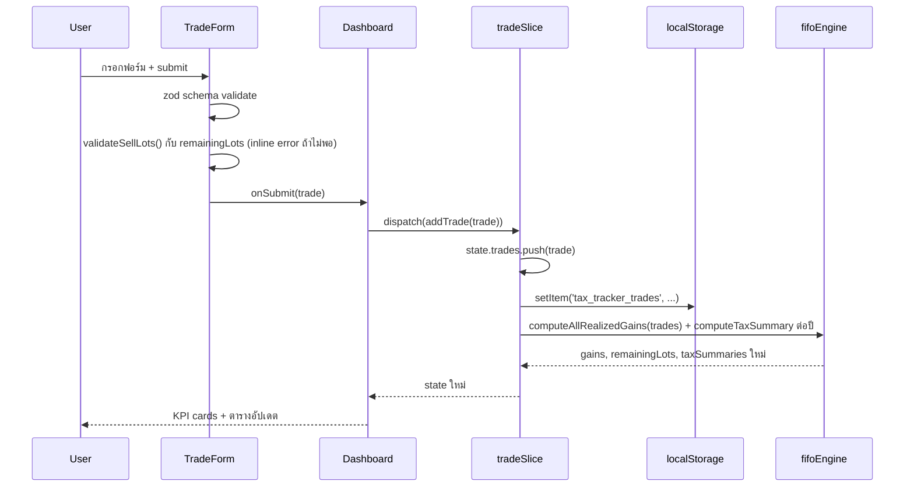

# สถาปัตยกรรม (Architecture)

เอกสารนี้อธิบายว่า code ถูกจัดวางอย่างไร ใครเรียกใคร และข้อมูลไหลผ่านอะไรบ้าง

---

## 1. Tech stack

ทุก version ตรงกับ `package.json` จริง

| ชั้น | เทคโนโลยี | Version |
|---|---|---|
| UI framework | React + React DOM | 19.2.7 |
| ภาษา | TypeScript (strict mode) | 6.0.2 |
| Build tool | Vite + @vitejs/plugin-react | 8.1.1 / 6.0.3 |
| State management | Redux Toolkit + react-redux | 2.12.0 / 9.3.0 |
| ฟอร์ม | react-hook-form + @hookform/resolvers | 7.83.0 / 5.5.3 |
| Validation | zod | 4.4.3 |
| i18n | i18next + react-i18next | 26.3.6 / 17.0.11 |
| Error handling | react-error-boundary | 6.1.2 |
| Test | jest + ts-jest + @testing-library/react | 30.4.2 / 29.4.12 / 16.3.2 |
| Lint | oxlint | 1.71.0 |

---

## 2. โครงสร้างโฟลเดอร์

```text
src/
├── main.tsx                    # entry point — ประกอบ provider ทั้งหมด
├── App.tsx                     # render <Dashboard /> ตัวเดียว
├── constants.ts                # STORAGE_KEYS, VALIDATION, COUNTRY_WHT_INFO, THAI_TAX
├── index.css / App.css         # global styles
│
├── types/
│   └── trade.ts                # interface ของ domain ทั้งหมด (type-only)
│
├── engine/                     # ★ PURE FUNCTIONS — หัวใจของ logic ทั้งหมด
│   ├── fifoEngine.ts           # FIFO, realized gain, remittance, tax summary
│   └── dividendEngine.ts       # dividend snapshot, WHT credit, สรุปภาษีรายปี
│
├── store/                      # Redux Toolkit
│   ├── index.ts                # configureStore
│   ├── hooks.ts                # useAppDispatch / useAppSelector (typed)
│   ├── tradeSlice.ts           # trades + remittances + tax summaries
│   ├── dividendSlice.ts        # dividend records + remittances
│   └── taxSlice.ts             # (ยังไม่ต่อ UI) คำนวณภาษีขั้นบันได
│
├── components/                 # React components
│   ├── Dashboard.tsx           # ★ component เดียวที่ต่อ Redux
│   ├── TradesTab.tsx
│   ├── DividendTab.tsx
│   ├── TradeTable.tsx
│   ├── RemittanceLog.tsx
│   ├── TradeForm.tsx
│   ├── RemitForm.tsx
│   ├── DividendForm.tsx
│   ├── DividendRemitForm.tsx
│   ├── KpiCard.tsx
│   ├── ConfirmDialog.tsx
│   ├── Tooltip.tsx
│   └── ErrorBoundary.tsx
│
├── context/
│   └── ThemeContext.tsx        # dark/light + persist
│
├── i18n/
│   ├── index.ts                # i18next init + persistLanguage()
│   └── locales/{th,en}/{common,trade,remittance,dividend}.json
│
└── validation/
    └── schemas.ts              # zod schema + safeParse สำหรับทุกการอ่าน localStorage
```

---

## 3. Component tree



**จุดสำคัญ:** `Dashboard` เป็น component **เดียว** ที่เรียก `useAppSelector` / `useAppDispatch`
ทุก component ที่เหลือเป็น presentational ล้วน — รับ `props` แล้ว render

ข้อดี: test ง่าย (ไม่มี mock store), logic ไม่กระจาย
ข้อเสีย: `Dashboard.tsx` โตมาก (เก็บ handler ทุกตัวไว้ที่เดียว) และ prop drilling ลึก

---

## 4. การแบ่งชั้น (layering rules)

```text
+-----------------------------------------------------------+
|  components/         React + JSX + local UI state         |
|                      ห้ามมี business logic               |
+-----------------------------------------------------------+
                          | เรียก
                          v
+-----------------------------------------------------------+
|  store/*Slice.ts     Redux state + persistence + migrate  |
|                      เรียก engine เพื่อคำนวณ                |
+-----------------------------------------------------------+
                          | เรียก
                          v
+-----------------------------------------------------------+
|  engine/*.ts         PURE FUNCTIONS                       |
|                      ห้าม import React / Redux / DOM      |
|                      input -> output เท่านั้น              |
+-----------------------------------------------------------+
```

`fifoEngine.ts` และ `dividendEngine.ts` **ไม่มี** import จาก `react`, `@reduxjs/toolkit`
หรือแตะ `window`/`localStorage` เลย — ทำให้เป็น pure function ที่ test ตรง ๆ ได้
และเป็นเหตุผลที่ coverage config วัดเฉพาะ `engine`, `store`, `validation`

---

## 5. Redux store



สร้างด้วย `configureStore` ธรรมดา ไม่มี middleware พิเศษ ไม่มี thunk ที่เขียนเอง
(ใช้ `createSlice` + `prepare` เท่านั้น)

### `tradeSlice` — state ที่สำคัญ

| Field | ที่มา | persist |
|---|---|---|
| `trades` | ผู้ใช้เพิ่ม/แก้/ลบ | ✅ `tax_tracker_trades` |
| `gains` | **คำนวณใหม่ทุกครั้ง** จาก `computeAllRealizedGains(trades)` | ❌ (ดู `tax_tracker_gains` ข้อ 6) |
| `remainingLots` | ผลพลอยได้จาก `computeAllRealizedGains` | ❌ |
| `taxSummaries` | `Record<year, TaxSummary>` คำนวณใหม่ทุกครั้ง | ❌ |
| `selectedTaxYear` | UI | ❌ (มาจากปีล่าสุดของ `taxSummaries`) |
| `remitTargetTradeId` | UI (เปิด modal) | ❌ |

### กฎที่สำคัญมาก: **คำนวณใหม่ทุกครั้ง ไม่เก็บ cache**

ทุก action ที่เปลี่ยน `trades` หรือ `remittances` จะเรียก
`recomputeGains` → `recomputeSummaries` แล้วเขียนทับ `gains` / `taxSummaries` ทั้งก้อน

```text
action (addTrade / updateTrade / deleteTrade / addRemittance / ...)
   |
   v
recomputeGains(trades, existingGains)
   |  -> computeAllRealizedGains(trades)  [ทุกปี ทุก symbol]
   v
recomputeSummaries(trades, gains)
   |  -> สำหรับแต่ละปีที่มี: computeTaxSummary(trades, year, gains)
   v
state.gains, state.remainingLots, state.taxSummaries ถูกแทนที่
```

เหตุผล: ข้อมูลมีขนาดเล็ก (หลักสิบ-ร้อยรายการ) การคำนวณใหม่ถูกกว่าการ manage
cache invalidation มาก และทำให้ไม่มีทางเกิด state ที่คำนวณค้างจากรอบก่อน

---

## 6. การไหลของข้อมูล (data flow)

### 6.1 ตอนแอปเริ่มทำงาน (app boot)



⚠️ จุดนี้คือที่มาของ known issue #1 (ดู [05-data-and-dev.md](./05-data-and-dev.md)) —
ถ้า `computeTaxSummary` throw ระหว่าง module init แอปจะจอขาวทันที เพราะ error เกิดก่อน
`AppErrorBoundary` จะ mount

### 6.2 ตอนผู้ใช้เพิ่มรายการขาย



### 6.3 ตอนโอนเงินกลับ (กรณีที่ซับซ้อนที่สุด)

```mermaid
sequenceDiagram
    U as User
    participant RF as RemitForm
    participant D as Dashboard
    participant St as tradeSlice
    participant Eng as fifoEngine

    U->>RF: จำนวน USD + FX + วันที่โอน
    RF->>RF: คำนวณ preview: taxableTHB = amountUSD * gainPercent * fx
    RF->>D: onSubmit(tradeId, remittance)
    D->>St: dispatch(addRemittance({ tradeId, remittance }))
    St->>Eng: applyRemittance() ต่อ gain ที่ match
    Note over St,Eng: throw ถ้า amountUSD <= 0,<br/>sellTradeId ไม่ตรง, หรือโอนเกิน remaining
    St->>Eng: computeTaxSummary ต่อปีใหม่ทั้งหมด
    St-->>D: taxSummaries ใหม่
```

---

## 7. ชั้น i18n

- 2 ภาษา: `th` (fallback), `en`
- 4 namespaces: `common`, `trade`, `remittance`, `dividend`
- ไฟล์อยู่ที่ `src/i18n/locales/<lang>/<ns>.json`
- ภาษาเริ่มต้นอ่านจาก `localStorage['lang']` ถ้าไม่มีใช้ `th`
- ตั้ง `returnNull: false` → key ที่ยังไม่แปลจะแสดงชื่อ key ตรง ๆ (เห็นง่ายเวลา dev)
- เปลี่ยนภาษาที่ header: `i18next.changeLanguage(next)` + `persistLanguage(next)`

---

## 8. ชั้นธีม

- ค่าเริ่มต้น: `dark` (ถ้าไม่มีค่าที่บันทึกไว้ จะดู `prefers-color-scheme` ประกอบ)
- เก็บที่ `localStorage['tax_tracker_theme']`
- ใส่ `data-theme="dark|light"` ที่ `<html>` แล้วให้ CSS ใช้ `[data-theme=...]`
- ตอนสลับธีมจะเติม class `no-transitions` ที่ `<html>` แล้วถอดออกใน double-`requestAnimationFrame`
  เพื่อกันไม่ให้สีทุก element transition พร้อมกันจนดูเหมือนจอกะพริบ

---

## 9. Error boundary

`AppErrorBoundary` ครอบทั้งแอป (อยู่นอก `Provider`) ใช้ `react-error-boundary`
ถ้า render throw จะแสดง fallback UI ที่แปลตามภาษาแล้ว พร้อมปุ่ม reload

ข้อจำกัด: จับได้เฉพาะ error ตอน **render** — ไม่จับ
① error ตอน import module (ดู 6.1) ② error ใน event handler ③ error ใน async

---

## 10. จุดที่ควรรู้ก่อนแก้ code

| ถ้าจะแก้... | ไปที่ |
|---|---|
| สูตรต้นทุน/กำไร/FIFO | `src/engine/fifoEngine.ts` |
| สูตรเงินปันผล/WHT | `src/engine/dividendEngine.ts` |
| โครงสร้างข้อมูลที่เก็บ | `src/types/trade.ts` + `src/validation/schemas.ts` |
| พฤติกรรมตอนโหลด/บันทึก | `src/store/tradeSlice.ts`, `dividendSlice.ts` |
| ปุ่ม/ฟอร์ม/หน้าจอ | `src/components/*` (เริ่มจาก `Dashboard.tsx`) |
| ข้อความ | `src/i18n/locales/**` (ต้องแก้ทั้ง `th` และ `en`) |
| ค่าคงที่/ขอบเขต validation | `src/constants.ts` |