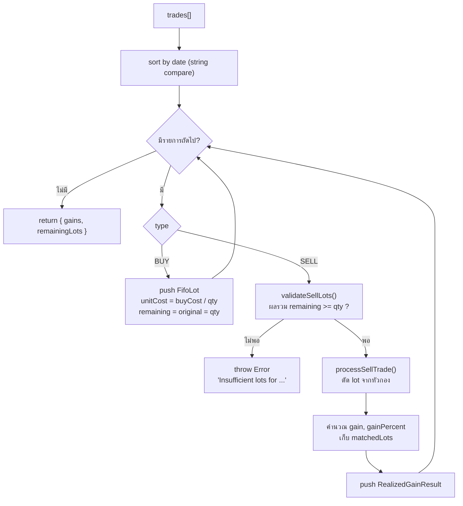

# รายการซื้อขายและ FIFO Engine

เอกสารนี้อธิบาย `src/engine/fifoEngine.ts` — ส่วนที่แปลง "รายการซื้อขายที่ผู้ใช้กรอก"
ให้เป็น "กำไรที่เกิดขึ้นจริง" ด้วยวิธี FIFO
(การแปลงกำไรเป็นภาษีต่อ อยู่ใน [03-remittance-tax.md](./03-remittance-tax.md))

---

## 1. โครงสร้างข้อมูล Trade

ทุกอย่างเป็น USD ทั้งหมด — ยังไม่มี THB ในขั้นนี้ (`src/types/trade.ts`)

```ts
interface TradeTransaction {
  id: string;
  date: string;          // 'YYYY-MM-DD' — ใช้ทั้งแสดงผลและเรียงลำดับ
  symbol: string;        // เช่น 'AAPL' (สูงสุด 10 ตัวอักษร)
  type: 'BUY' | 'SELL';
  provider: 'Dime' | 'Liberator' | 'FinansiaSyrus';
  quantity: number;
  priceUSD: number;      // ราคาต่อหน่วย

  // ค่าธรรมเนียม (USD ทั้งหมด — ไม่ใช่บาท)
  commissionUSD: number;
  exchangeFeeUSD: number;
  tafFeeUSD: number;            // ใช้เฉพาะ SELL
  commissionRebateUSD: number;  // ส่วนลด/คืนค่าคอม
  vatUSD: number;

  notes?: string;
}
```

> ⚠️ `provider` เป็นส่วนหนึ่งของ identity ของ lot ด้วย — AAPL ที่ Dime และ AAPL ที่ Liberator
> ถือเป็น **คนละกอง** ห้ามตัดข้ามกัน (เพราะเป็นบัญชี/ต้นทุนคนละที่)

---

## 2. สูตรต้นทุนและรายได้

### 2.1 ต้นทุนการซื้อ (Buy cost)

$$
\text{buyCost} = q \times p + \text{commission} + \text{exchangeFee} + \text{vat} - \text{rebate}
$$

| สัญลักษณ์ | ความหมาย |
|---|---|
| $q$ | `quantity` |
| $p$ | `priceUSD` |

**ค่าธรรมเนียมทุกตัวบวกเข้าไปในต้นทุน** (ยกเว้น rebate ที่ลบออก) เพราะเป็นเงินที่จ่ายจริง
ผลลัพธ์: ต้นทุนต่อหน่วยสูงกว่าราคาที่เห็นบนจอเล็กน้อย

$$
\text{unitCost} = \frac{\text{buyCost}}{q}
$$

### 2.2 รายได้จากการขาย (Sell revenue)

$$
\text{sellRevenue} = q \times p - \text{commission} - \text{exchangeFee} - \text{tafFee} - \text{vat} + \text{rebate}
$$

**ค่าธรรมเนียมทุกตัวลบออกจากรายได้** เพราะเป็นเงินที่ไม่ได้กลับมา
(สังเกตว่า rebate มีเครื่องหมายกลับกับฝั่งซื้อ — ทั้งสองฝั่งคือ "เงินที่ได้คืน")

### 2.3 กำไรที่เกิดขึ้นจริง (Realized gain)

$$
\text{gain} = \text{sellRevenue} - \text{costBasis}
$$

$$
\text{gainPercent} = \frac{\text{gain}}{\text{sellRevenue}} \quad (\text{ถ้า } \text{sellRevenue} \le 0 \Rightarrow 0)
$$

`gainPercent` คือค่าที่สำคัญที่สุดในระบบ เพราะใช้แยก "ส่วนที่เป็นกำไร" ออกจาก
"เงินต้นที่โอนกลับ" ตอนคำนวณภาษี (ดู [03](./03-remittance-tax.md))

`gainPercent` เป็น **ลบได้** (กรณีขาดทุน) และช่วงค่าคือ $(-\infty, 1)$ ในทางปฏิบัติ

---

## 3. อัลกอริทึม FIFO

### 3.1 กติกาหลัก

```text
1. เรียง trade ทั้งหมดตาม date จากน้อยไปมาก
2. ไล่ทีละรายการ
   - ถ้า BUY -> สร้าง lot ใหม่ ต่อท้ายกองของ key "SYMBOL|PROVIDER"
   - ถ้า SELL -> ตัด lot จากหัวกองไปเรื่อย ๆ จนครบจำนวน
                ถ้าตัดไม่ครบ -> throw Error (ไม่ยอมให้ขายเกินที่มี)
3. lot ที่ถูกตัดบางส่วนยังเหลือในกองพร้อม remainingQuantity ที่ลดลง
4. lot ที่เหลือทั้งหมดหลังประมวลผล = remainingLots
```

### 3.2 Diagram



### 3.3 ทำไมต้องเรียงด้วย `localeCompare` บน string

วันที่ถูกเก็บเป็น `'YYYY-MM-DD'` ซึ่ง lexicographic order = chronological order อยู่แล้ว
จึงไม่ต้องแปลงเป็น `Date` (เลี่ยงปัญหา timezone ทั้งหมด)

**ข้อควรระวัง:** ถ้ารายการหลายรายการมีวันที่เดียวกัน ลำดับจะขึ้นกับลำดับใน array เดิม
(JavaScript `sort` เป็น stable sort) — ถ้า BUY กับ SELL วันเดียวกัน ให้ BUY มาก่อนใน array
ผลลัพธ์จึงจะถูก

### 3.4 ฟังก์ชันที่เปิดให้ใช้

| ฟังก์ชัน | Input | Output | หมายเหตุ |
|---|---|---|---|
| `calculateBuyCostUSD(trade)` | trade | number | คืน 0 ถ้าไม่ใช่ BUY |
| `calculateSellRevenueUSD(trade)` | trade | number | คืน 0 ถ้าไม่ใช่ SELL |
| `calculateUnitCostUSD(trade)` | trade | number | `cost / qty`, คืน 0 ถ้า qty = 0 |
| `validateSellLots(sell, lots)` | sell, lots | `LotValidationResult` | ใช้ทั้งใน UI และ engine |
| `processSellTrade(sell, lots)` | sell, lots | `{ result, updatedLots }` | throw ถ้าตัด lot ไม่ครบ |
| `computeAllRealizedGains(trades, excludeId?)` | trades | `{ gains, remainingLots }` | ตัวหลัก |
| `applyRemittance(gain, remit)` | gain, remit | gain ใหม่ | ดู [03](./03-remittance-tax.md) |
| `computeTaxableGainsTHB(gains)` | gains | `{ taxableGainTHB, excludedLossesTHB }` | ดู [03](./03-remittance-tax.md) |
| `computeTaxSummary(trades, year, allGains)` | trades, year | `TaxSummary` | ดู [03](./03-remittance-tax.md) |

`excludeTradeId` มีไว้ให้หน้าแก้ไข (edit) คำนวณสถานะ "ถ้าไม่มีรายการนี้" เพื่อเช็คว่า
ถ้าแก้จำนวนจะยังมี lot พอหรือไม่

---

## 4. ตัวอย่างคำนวณจริง (ตรวจสอบกับ code แล้ว)

ข้อมูลตั้งต้น — ซื้อ AAPL ที่ Dime สองครั้ง แล้วขาย 12 หุ้น

| # | วันที่ | ประเภท | จำนวน | ราคา | ค่าคอม | TAF | VAT |
|---|---|---|---|---|---|---|---|
| b1 | 2025-01-10 | BUY | 10 | $100 | $1 | – | – |
| b2 | 2025-03-05 | BUY | 5 | $120 | $1 | – | – |
| s1 | 2025-06-01 | SELL | 12 | $150 | $1 | $0.02 | $0.07 |

### ขั้นที่ 1 — คำนวณต้นทุน lot

$$
\text{buyCost}_{b1} = 10 \times 100 + 1 = 1001 \;\Rightarrow\; \text{unitCost} = 100.10
$$

$$
\text{buyCost}_{b2} = 5 \times 120 + 1 = 601 \;\Rightarrow\; \text{unitCost} = 120.20
$$

### ขั้นที่ 2 — คำนวณรายได้จากการขาย

$$
\text{sellRevenue} = 12 \times 150 - 1 - 0 - 0.02 - 0.07 = 1798.91
$$

### ขั้นที่ 3 — ตัด lot แบบ FIFO (ต้องการ 12 หน่วย)

```text
กอง AAPL|Dime ก่อนขาย:
  [b1] 10 หน่วย @ 100.10
  [b2]  5 หน่วย @ 120.20

ตัด 12 หน่วย:
  เอา b1 ทั้งก้อน  10 หน่วย -> cost 10 * 100.10 = 1001.00   (เหลือต้องการ 2)
  เอา b2 บางส่วน    2 หน่วย -> cost  2 * 120.20 =  240.40   (เหลือต้องการ 0)

costBasis = 1241.40
```

```text
กอง AAPL|Dime หลังขาย:
  [b2] 3 หน่วย @ 120.20   <- กลายเป็น remainingLots
```

### ขั้นที่ 4 — กำไร

$$
\text{gain} = 1798.91 - 1241.40 = 557.51
$$

$$
\text{gainPercent} = \frac{557.51}{1798.91} = 0.309915\ldots \approx 30.99\%
$$

### ผลลัพธ์ที่ได้จาก engine จริง

```text
buyCost b1 = 1001        unit = 100.1
buyCost b2 = 601         unit = 120.2
sellRevenue s1 = 1798.91
costBasis = 1241.4   gain = 557.51   gainPercent = 0.3099154487995508
matched: [ {b1, 10 @ 100.1 = 1001}, {b2, 2 @ 120.2 = 240.4} ]
remainingLots: [ {b2, remaining 3 of 5, unit 120.2} ]
```

---

## 5. Validation ที่เกี่ยวข้อง (ฝั่ง UI)

`src/validation/schemas.ts` + `src/constants.ts`

| กฎ | ค่า | ที่บังคับ |
|---|---|---|
| `symbol` ยาวสุด | 10 ตัวอักษร | zod schema |
| `quantity` | $> 0$ และ $\le 1{,}000{,}000$ | zod schema |
| `priceUSD` | $0.0001 \ldots 1{,}000{,}000$ | zod schema |
| วันที่ | ต้องไม่เป็นอนาคต | zod + `DATE_LIMITS` |
| วันที่ย้อนหลังสุด | 5 ปี (`MAX_PAST_YEARS`) | zod |
| ปีที่เร็วสุด | 2000 (`EARLIEST_YEAR`) | zod |
| ขายเกิน lot ที่มี | บล็อกที่ฟอร์ม + throw ที่ engine | `validateSellLots` |
| rebate > ค่าธรรมเนียมรวม | บล็อก | zod refine |
| แก้/ลบ SELL ที่มีการโอนแล้ว | บล็อก | `Dashboard` guard |

กรณี "ขายเกิน lot" — ฟอร์มจะเช็คก่อน submit และขึ้นข้อความ inline
ถ้าหลุดมาถึง engine จะ `throw` เป็นชั้นป้องกันที่สอง

---

## 6. ข้อจำกัดที่ตั้งใจไว้

1. **ไม่มี short selling** — ต้องมี lot ก่อนจึงจะขายได้
2. **ไม่มี fractional-cost averaging** — ใช้ FIFO เท่านั้น ไม่มีตัวเลือก LIFO/avg cost
3. **ไม่มี corporate action** — split, merger, spin-off ไม่รองรับ (ต้องแก้ด้วยมือ)
4. **ไม่มีการแปลงสกุลเงินในขั้นนี้** — ทุกอย่างเป็น USD จนถึงขั้นคำนวณภาษี
5. **ค่าธรรมเนียมเป็น USD** — ถ้าโบรกเกอร์หักเป็นบาท ต้องแปลงเองก่อนกรอก

---

## 7. จุดที่ควรระวังเมื่อแก้ engine

- `lotKey = symbol + '|' + provider` — ถ้าเปลี่ยน separator ต้อง migrate ข้อมูลเก่าไม่ได้
  (แต่ lot ไม่ได้ persist จึงปลอดภัย)
- `remainingLots` ถูกส่งเข้า `TradeForm` เพื่อแสดง "จำนวนที่ขายได้" ถ้าเปลี่ยนรูป
  shape ต้องแก้ `getAvailableQty` ใน `TradeForm.tsx` ด้วย
- `computeAllRealizedGains` ถูกเรียกซ้ำหลายครั้งต่อ 1 action (ครั้งเดียวต่อปีใน
  `computeTaxSummary`) — เป็น O(years × n log n) ซึ่งยอมรับได้ที่ขนาดข้อมูลหลักร้อย
- **ห้ามให้ `gainPercent` เป็น `NaN`** — ถ้า `sellRevenue <= 0` code คืน 0 ไว้แล้ว
  ถ้าแก้สูตรต้องคง guard นี้ไว้