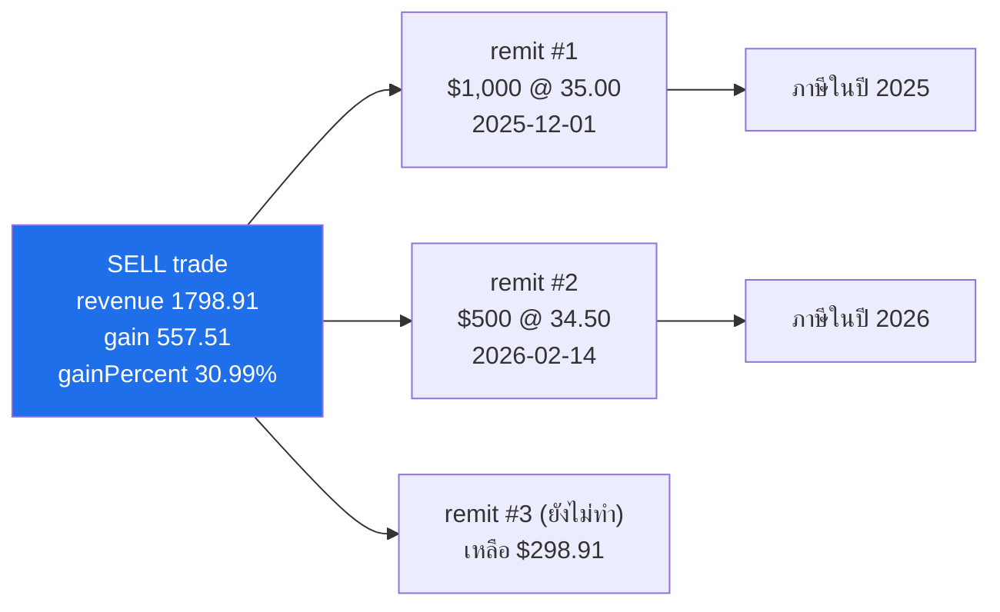
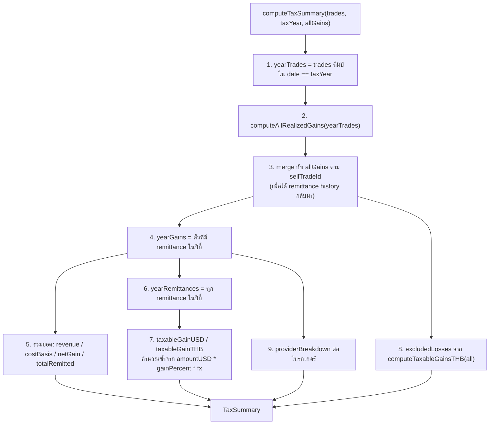

# การโอนเงินกลับและการคำนวณภาษี

เอกสารนี้อธิบาย **หัวใจทางกฎหมายของแอป**: กำไรจากหุ้นต่างประเทศจะกลายเป็นเงินได้
ที่ต้องเสียภาษีไทย **ก็ต่อเมื่อโอนเงินกลับเข้าไทย** และคำนวณด้วยอัตราแลกเปลี่ยนของ
**วันที่โอน** ไม่ใช่วันที่ขาย

หัวข้อนี้ผูกกับ `applyRemittance` และ `computeTaxSummary` ใน `src/engine/fifoEngine.ts`

---

## 1. หลักการ

```text
ขายหุ้น (SELL)  --> เกิด "กำไรที่ยังไม่เกิดภาษี" (unrealized tax event)
                     |
                     |  ยังไม่ต้องเสียภาษี ถ้ายังกองอยู่ต่างประเทศ
                     v
โอนเงินกลับไทย (REMITTANCE)  -->   ภาษี "เกิด" ที่จุดนี้
                                   ปีภาษี = ปีที่เงินถึงไทย
                                   FX = อัตรา ณ วันโอน
```

เพราะการโอนมักทำหลายครั้ง (ทีละส่วน) ระบบจึงต้องเก็บ remittance เป็นรายการย่อย
**แนบกับ SELL แต่ละรายการ** ไม่ใช่ก้อนเดียวต่อปี



---

## 2. โครงสร้างข้อมูล Remittance

```ts
interface RemittanceRecord {
  id: string;
  sellTradeId: string;   // ผูกกับ SELL ตัวไหน (ต้องตรงกันเป๊ะ)
  amountUSD: number;     // จำนวนที่โอน (USD)
  remitDate: string;     // 'YYYY-MM-DD' — วันที่เงินถึงไทย → ตัวกำหนดปีภาษี
  fxRateTHB: number;     // บาทต่อ 1 USD ณ วันโอน
  notes?: string;
}
```

**ไม่มีการเก็บค่า THB ลงในข้อมูล** — `amountTHB` และ `taxableTHB` คำนวณสดทุกครั้งที่แสดงผล
(`RemittanceLog.tsx`) เพื่อไม่ให้ค่าที่บันทึกไว้กับค่าที่คำนวณได้ขัดกัน

---

## 3. การคำนวณภาษีต่อ 1 การโอน

### 3.1 สูตร

$$
\text{taxableUSD} = \max\left(0,\; \text{amountUSD} \times \text{gainPercent}\right)
$$

$$
\text{taxableTHB} = \text{taxableUSD} \times \text{fxRateTHB}
$$

เหตุผลของแต่ละส่วน:

| ส่วน | ทำไม |
|---|---|
| $\times\, \text{gainPercent}$ | เงินที่โอนกลับประกอบด้วย "เงินต้น + กำไร" เฉพาะส่วนกำไรที่ต้องเสียภาษี สัดส่วนกำไรคงที่ตลอดทั้งรายการขาย |
| $\times\, \text{fxRateTHB}$ | แปลงเป็นบาทด้วยอัตรา **วันโอน** ตามที่ประมวลรัษฎากรกำหนด |
| $\max(0, \cdot)$ | ถ้าขาดทุน (`gainPercent < 0`) จะได้ภาษีติดลบไม่ได้ — ต้องเป็น 0 |

### 3.2 ตัวอย่างจากตัวเลขจริงใน [02](./02-trades-fifo.md#4-ตัวอย่างคำนวณจริง-ตรวจสอบกับ-code-แล้ว)

รายการขาย: revenue $1,798.91, gain $557.51, `gainPercent` = 0.309915

โอน $1,000 วันที่ 2025-12-01 ที่ FX 35.00:

$$
\text{taxableUSD} = 1000 \times 0.309915 = 309.92
$$

$$
\text{taxableTHB} = 309.92 \times 35.00 = 10{,}847.04
$$

ผลจาก engine จริง: `taxableTHB = 10847.040707984279`, `remainingProceedsUSD = 798.91`

### 3.3 Guardrail ใน `applyRemittance`

ฟังก์ชันนี้ **throw** ใน 3 กรณี (ไม่ยอมให้ข้อมูลเพี้ยนเข้า state):

| เงื่อนไข | ข้อความ error |
|---|---|
| `amountUSD <= 0` | `Remittance amount must be positive` |
| `remittance.sellTradeId !== gainResult.sellTradeId` | `Remittance does not match sell trade` |
| โอนรวมเกิน proceeds | `Remittance exceeds remaining proceeds. Available: $…` |

การโอนเกิน proceeds ถูกบล็อกที่ UI ก่อนแล้ว (`RemitForm` เทียบกับ
`remainingProceedsUSD`) แต่ engine ยังกันไว้อีกชั้น

### 3.4 ฟังก์ชันเป็น immutable

`applyRemittance` คืน object ใหม่ (`{...gainResult, ...}`) ไม่แก้ของเดิม — ทำให้
คำนวณซ้ำ/ย้อนกลับได้ปลอดภัย (เช่น ตอนลบ remittance แล้วคำนวณใหม่ทั้งชุด)

---

## 4. ขาดทุนหักกับกำไรไม่ได้

ประมวลรัษฎากรไทยไม่ให้เอาขาดทุนจากหุ้นต่างประเทศมาหักกับกำไร
`computeTaxableGainsTHB` จึงแยกสองถัง:

$$
\text{taxableGainTHB} = \sum_{g:\; \text{gain}_g > 0} \text{taxableGainTHB}_g
$$

$$
\text{excludedLosses} = \sum_{g:\; \text{gain}_g < 0} \left| \text{gainUSD}_g \right|
$$

รายการที่กำไรเป็นลบ **ถูกข้ามทั้งรายการ** — ไม่ถูกนำมาหักลบ และไม่ถูกนับเป็นภาษี

> 🐞 **ข้อบกพร่องเรื่องชื่อ**: ตัวแปรชื่อ `excludedLossesTHB` และ field
> `TaxSummary.excludedLossesUSD` แต่ค่าจริงที่ใส่เข้าไปคือ `Math.abs(gainUSD)` ซึ่งเป็น **USD**
> ตัวเลขที่แสดงจึงเป็น USD ไม่ใช่บาท (ดู [05](./05-data-and-dev.md))

---

## 5. `computeTaxSummary` — สรุปภาษีรายปี

### 5.1 ขั้นตอน



### 5.2 ความหมายของแต่ละ field

| Field | ความหมาย | หน่วย |
|---|---|---|
| `totalRevenueUSD` | รายได้รวมจากการขายที่ถูกโอนในปีนี้ | USD |
| `totalCostBasisUSD` | ต้นทุนรวมของรายการเหล่านั้น | USD |
| `netGainUSD` | กำไรสุทธิ (รวมขาดทุนแล้ว — เพื่อ **แสดงผล** เท่านั้น) | USD |
| `totalRemittedUSD` | ยอดโอนรวมในปีนี้ | USD |
| `taxableGainUSD` | ส่วนกำไรของยอดโอน | USD |
| `taxableGainTHB` | **ตัวเลขหลักที่เอาไปกรอกแบบ** | THB |
| `excludedLossesUSD` | ขาดทุนที่หักไม่ได้ (ค่าจริงเป็น USD) | USD |
| `totalTransactions` | จำนวน trade ในปีนี้ (ทั้งซื้อและขาย) | – |
| `totalBuyCount` / `totalSellCount` | แยกนับ | – |
| `totalRemittanceCount` | จำนวนครั้งที่โอนในปีนี้ | – |
| `providerBreakdown` | ยอดแยกตาม Dime / Liberator / FinansiaSyrus | – |

`providerBreakdown` มีไว้ทำ KPI แถวที่สองใน `TradesTab` เพื่อให้เห็นว่าภาษี
มาจากโบรกเกอร์ไหนเท่าไหร่ และคิดเป็นสัดส่วนกี่ % ของยอดรวม

### 5.3 หลักการที่พึงระวัง: `netGainUSD ≠ ภาษี`

`netGainUSD` ใช้ **แสดงผล** ให้เห็นภาพรวมกำไร/ขาดทุน แต่ **ห้ามนำไปคำนวณภาษี**
เพราะขาดทุนหักไม่ได้ — ค่าที่ใช้คำนวณภาษีคือ `taxableGainTHB` เท่านั้น

---

## 6. พฤติกรรมจริงที่ตรวจสอบแล้ว (สำคัญ)

รัน engine ตรง ๆ เพื่อยืนยัน พบ 2 ปัญหาที่มีผลกับตัวเลขภาษีจริง

### 6.1 ❗ ขายคนละปีกับที่ซื้อ → engine throw → แอปจอขาว

```text
ซื้อ AAPL 2024-03-01, ขาย 2025-06-01
computeTaxSummary(trades, 2025, ...)  ->  throw
"Insufficient lots for AAPL via Dime. Available: 0, Requested: 10"
```

สาเหตุ: `computeTaxSummary` กรอง trade เหลือ **เฉพาะปีภาษี** แล้วเรียก
`computeAllRealizedGains(yearTrades)` ใหม่ → ไม่เห็น BUY ของปีก่อน → ตัด lot ไม่ได้ → throw

ความรุนแรง: `tradeSlice` เรียก `recomputeSummaries` ใน `buildInitialState()` **ตอน import module**
ดังนั้นถ้าใน `localStorage` มีข้อมูลลักษณะนี้ แอปจะ throw ก่อน React mount
→ `AppErrorBoundary` จับไม่ได้ → หน้าจอขาวทุกครั้ง

### 6.2 ❗ โอนเงินคนละปีกับที่ขาย → ภาษีกลายเป็น 0

```text
ซื้อ 2025-01-10, ขาย 2025-06-01 (กำไร $1,000, gainPercent 50%)
โอน $2,000 วันที่ 2026-01-15 @ 35.00

applyRemittance(...)          -> taxableGainTHB = 35,000.00   ✅ ถูก
computeTaxSummary(trades, 2026) -> taxableGainTHB = 0.00       ❌ ควรเป็น 35,000
computeTaxSummary(trades, 2025) -> taxableGainTHB = 0.00       ❌
```

สาเหตุ: ทั้ง `yearGains` และ `yearRemittances` ล้วนถูกกรองจาก `mergedGains` ที่มาจาก
`yearTrades` (trade ที่ **ลงวันที่** ในปีภาษี) เท่านั้น remittance ของรายการขายปีก่อน
จึงหลุดออกไปทั้งหมด

ผลรวม: **แอปรายงานภาษีถูกต้องเฉพาะกรณีที่ ซื้อ + ขาย + โอน อยู่ในปีปฏิทินเดียวกัน**
ซึ่งขัดกับหลักการ "ภาษีเกิดเมื่อโอน" ที่แอปนี้อุทิศให้

> 📌 ข้อสังเกต: ตัวเลข `applyRemittance` (ซึ่งเก็บใน `state.gains`) **ถูกต้องเสมอ**
> ปัญหาอยู่ที่ `computeTaxSummary` ที่คำนวณซ้ำด้วยวิธีที่ผิด
> แนวทางแก้ที่ตรงไปตรงมาคือให้ summary รวม `taxableGainTHB` จาก `allGains` แทนการคำนวณใหม่
> (ดู [05](./05-data-and-dev.md#5-ข้อควรระวังและปัญหาที่รู้อยู่))

---

## 7. การไหลใน UI

### 7.1 บันทึกการโอน (`RemitForm`)

```text
1. เลือก "รายการขายที่จะโอน" จาก dropdown
   → แสดงเฉพาะ gain ที่ remainingProceedsUSD > 0
   → ตอน edit จะรวมรายการเดิมเข้าไปด้วย
2. กรอกจำนวน USD, วันที่โอน, FX
3. เห็น preview สด ๆ:
     โอน        $1,000.00
     ส่วนกำไร   30.99%  →  $309.92
     ส่วนต้นทุน         →  $690.08
     ภาษีประมาณ  $309.92 × 35.00 = ฿10,847.04
4. ปุ่ม "โอนที่เหลือทั้งหมด" เติม remainingProceedsUSD ให้อัตโนมัติ
5. submit → dispatch(addRemittance) → engine คำนวณใหม่ทั้งชุด
```

### 7.2 ข้อห้ามที่ UI บังคับ

| การกระทำ | ผล |
|---|---|
| แก้ไข / ลบ SELL ที่มี remittance แล้ว | บล็อก พร้อมบอกให้ลบการโอนก่อน (`trade:remitBeforeEdit`) |
| โอนเกิน `remainingProceedsUSD` | บล็อกที่ฟอร์ม + throw ที่ engine |
| วันที่โอนในอนาคต | บล็อกที่ zod schema |
| FX นอกช่วง 20–50 | บล็อกที่ zod schema |

### 7.3 แท็บรายการโอน (`RemittanceLog`)

- flatten remittance จากทุก gain แล้วคำนวณ `amountTHB` / `taxableTHB` สด
- กรองตามปีที่โอน (ปีเริ่มต้น = ปีล่าสุดที่มีข้อมูล)
- แถวรวม (tfoot): ยอดโอน USD, ยอดโอน THB, ภาษีรวม THB
- ลบได้ → dispatch `removeRemittance` → คำนวณกำไรใหม่ทั้งชุด

---

## 8. สรุปสูตรทั้งหมดในหน้านี้

$$
\text{taxableTHB per remittance} = \max(0,\ \text{amountUSD} \times \text{gainPercent}) \times \text{fxRateTHB}
$$

$$
\text{gainPercent} = \frac{\text{sellRevenue} - \text{costBasis}}{\text{sellRevenue}}
$$

$$
\text{remainingProceedsUSD} = \text{sellRevenue} - \sum \text{amountUSD}
$$

$$
\text{TaxSummary.taxableGainTHB} = \sum_{\text{remit ในปี}} \left( \text{amountUSD} \times \text{gainPercent} \times \text{fxRateTHB} \right)
$$