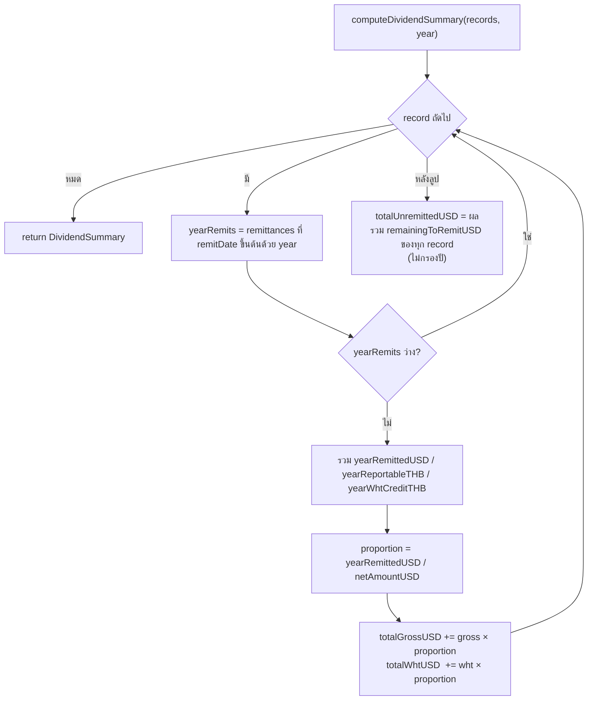

# เงินปันผลต่างประเทศ (Dividends)

เอกสารนี้อธิบาย `src/engine/dividendEngine.ts` และหน้าจอเงินปันผล
จุดที่ต่างจากหุ้นคือ: **เงินปันผลถูกหักภาษีที่ประเทศต้นทางไปแล้ว (WHT)** จึงต้อง
"เคลมเครดิต" ภาษีนั้นกลับมาได้

---

## 1. ทำไมเงินปันผลต้องมี FX สองตัว

นี่คือจุดที่เข้าใจผิดบ่อยที่สุดของแอปนี้ และเป็นเหตุผลที่ต้องมีฟิลด์ FX ถึงสองตัว

```text
    วันรับเงินปันผล                      วันโอนเงินเข้าไทย
    (dividend date)                    (remittance date)
          |                                   |
          v                                   v
   dividendFxRate                        remitFxRate
          |                                   |
          +---> THB snapshot (อ้างอิง)         +---> ภาษีจริง
                grossAmountTHB                   remitTHB
                whtAmountTHB                     reportableIncomeTHB
                netAmountTHB                     whtCreditTHB
```

| ค่า | ใช้ FX ตัวไหน | ใช้ทำอะไร |
|---|---|---|
| `grossAmountTHB` | `dividendFxRate` | แสดงผล / อ้างอิง |
| `whtAmountTHB` | `dividendFxRate` | แสดงผล / อ้างอิง |
| `netAmountTHB` | `dividendFxRate` | แสดงผล / อ้างอิง |
| `remitTHB` | `remitFxRate` | **เงินได้ที่ต้องรายงาน** |
| `reportableIncomeTHB` | `remitFxRate` | **เงินได้ที่ต้องรายงาน** (= `remitTHB`) |
| `whtCreditTHB` | `remitFxRate` | **เครดิตภาษีที่เคลมได้** |

> 🔒 **กฎเหล็ก (BR2 ใน code):** ค่าที่เกิดจาก `dividendFxRate` เป็น **snapshot เพื่อดูเท่านั้น**
> ห้ามนำไปคำนวณภาษี ส่วนค่าที่ใช้รายงานต้องมาจาก `remitFxRate` เท่านั้น
> และโดยการออกแบบ `reportableIncomeTHB ≡ remitTHB` เสมอ (ไม่ใช่ `netAmountTHB`)

---

## 2. ขั้นตอนการบันทึกเงินปันผล

### 2.1 ฟอร์ม (`DividendForm`)

```text
1. เลือก Symbol   → dropdown มาจาก getAvailableSymbols(trades)
                    = symbol ที่มีอยู่ในรายการ BUY เท่านั้น
2. เลือก Country  → US / UK / SG / OTHER
                    เปลี่ยนแล้วเติม WHT rate เริ่มต้นให้อัตโนมัติ
3. กรอกวันที่, grossAmountUSD, FX ณ วันรับเงิน
4. ระบบคำนวณให้ทันที:
      whtAmountUSD   = grossAmountUSD × whtRate / 100
      netAmountUSD   = grossAmountUSD − whtAmountUSD
      gross/net/wht THB  (snapshot)
5. บันทึก
```

ผู้ใช้ **แก้ `whtRate` เองได้** เพราะบางครั้งถูกหักจริงไม่ตรงกับอัตราในอนุสัญญา

### 2.2 ตัวเลขที่ engine คำนวณให้ (`calculateDividendTHB`)

$$
\text{whtAmountUSD} = \text{grossAmountUSD} \times \frac{\text{whtRate}}{100}
$$

$$
\text{netAmountUSD} = \text{grossAmountUSD} - \text{whtAmountUSD}
$$

$$
\text{grossAmountTHB} = \text{grossAmountUSD} \times \text{dividendFxRate}
$$

---

## 3. อัตรา WHT เริ่มต้นตามประเทศ

จาก `COUNTRY_WHT_INFO` ใน `src/constants.ts`

| ประเทศ | อัตราเริ่มต้น | มี DTA | หมายเหตุใน code |
|---|---|---|---|
| **US** | 15% | ✅ | US–Thai Treaty Article 10; ถ้าไม่มี W-8BEN จะถูกหัก 30% |
| **UK** | 0% | ✅ | ไม่มีการหัก ณ ที่จ่าย |
| **SG** | 0% | ✅ | ไม่มีการหัก ณ ที่จ่าย |
| **OTHER** | 0% | ❌ | ต้องตรวจสอบเอง |

> ผู้ใช้แก้ไขได้เสมอ — อัตรานี้เป็นเพียงค่าเริ่มต้นของฟอร์ม

---

## 4. การโอนเงินปันผลกลับ และเครดิต WHT

### 4.1 หลักการ

เงินปันผลที่ได้รับคือ `netAmountUSD` (หลังถูกหัก WHT ไปแล้ว) เมื่อโอนกลับ
**ทั้งก้อนที่โอนคือเงินได้ที่ต้องรายงาน** (ไม่ใช่แค่กำไรเหมือนหุ้น) เพราะเงินปันผล
เป็นเงินได้ทั้งจำนวน ไม่ใช่ capital gain

$$
\text{reportableIncomeTHB} = \text{amountUSD} \times \text{remitFxRate}
$$

$$
\text{whtCreditTHB} = \frac{\text{amountUSD}}{\text{netAmountUSD}} \times \text{whtAmountUSD} \times \text{remitFxRate}
$$

สมการที่สองคือ **เครดิตภาษีแบบสัดส่วน** — ถ้าโอนบางส่วน จะเคลมเครดิตได้ตามสัดส่วน
ของเงินปันผลสุทธิที่โอนจริง

### 4.2 `calculateWhtCredit` — ตรวจ guard

```ts
if (netAmountUSD <= 0) return 0;
const proportion = remitAmountUSD / netAmountUSD;
return proportion * whtAmountUSD * remitFxRate;
```

กัน `divide by zero` ไว้แล้ว — ถ้า `netAmountUSD` เป็น 0 (กรณีที่ WHT 100%) เครดิตเป็น 0

### 4.3 ตัวอย่าง

รับเงินปันผล AAPL: gross $100, WHT 15% → WHT $15, net $85, FX วันรับ 34.00

| ค่า snapshot | บาท |
|---|---|
| `grossAmountTHB` | ฿3,400.00 |
| `whtAmountTHB` | ฿510.00 |
| `netAmountTHB` | ฿2,890.00 |

โอนทั้งหมด $85 วันที่ 2025-11-20 ที่ FX 35.00:

$$
\text{reportableIncomeTHB} = 85 \times 35 = 2{,}975.00
$$

$$
\text{whtCreditTHB} = \frac{85}{85} \times 15 \times 35 = 525.00
$$

จะเห็นว่า snapshot (฿2,890) กับยอดที่รายงานจริง (฿2,975) **ไม่เท่ากัน** เพราะ FX ต่างวัน
นี่คือพฤติกรรมที่ถูกต้อง ไม่ใช่ bug — และเป็นเหตุผลที่ต้องมี FX สองตัว

ถ้าโอนเพียง $42.50 (ครึ่งเดียว):

$$
\text{whtCreditTHB} = \frac{42.5}{85} \times 15 \times 35 = 262.50
$$

---

## 5. การตรวจสอบก่อนบันทึก (`validateRemittance`)

```ts
if (amountUSD <= 0)      → 'จำนวนเงินต้องมากกว่า 0'
if (amountUSD > remainingToRemitUSD)
   → 'จำนวนเงินเกินที่สามารถนำเข้าได้ ($ X.XX)'
```

> ⚠️ ข้อความ error เป็น **ภาษาไทย hardcode** อยู่ใน engine ไม่ผ่าน i18n
> ต่างจากข้อความอื่นของแอป (ดู [05](./05-data-and-dev.md))

`applyDividendRemittance` เรียก `validateRemittance` ก่อน แล้ว **throw** ถ้าไม่ผ่าน
จากนั้นคืน `DividendRecord` ใหม่ (immutable) พร้อม:
- `remittances` ต่อท้าย
- `totalRemittedUSD` = ผลรวมใหม่
- `remainingToRemitUSD = netAmountUSD − totalRemittedUSD`

---

## 6. การสรุปภาษีรายปี (`computeDividendSummary`)

### 6.1 กติกาการจัดปี

```text
เงินปันผล 1 รายการ จะถูกนับในปี X ก็ต่อเมื่อ "มีการโอนในปี X"
ไม่ใช่ปีที่รับเงินปันผล
```

ถ้าโอนครั้งเดียวในปี 2026 แต่รับเงินปันผลปี 2024 → นับเป็นรายได้ปี 2026

### 6.2 อัลกอริทึม



### 6.3 ความหมายของแต่ละ field

| Field | ความหมาย | หน่วย |
|---|---|---|
| `totalGrossUSD` | gross ตามสัดส่วนที่โอนในปีนั้น | USD |
| `totalWhtUSD` | WHT ตามสัดส่วนเดียวกัน | USD |
| `totalNetUSD` | ผลรวมเงินที่โอนในปีนั้น | USD |
| `totalRemittedUSD` | เท่ากับ `totalNetUSD` | USD |
| `totalReportableIncomeTHB` | **เงินได้ที่ต้องรายงาน** | THB |
| `totalWhtCreditTHB` | **เครดิตภาษีที่เคลมได้** | THB |
| `totalUnremittedUSD` | ยอดที่ยังไม่โอน (ของทุกปีรวมกัน) | USD |
| `recordCount` / `remittedCount` | จำนวน record ที่เข้าเงื่อนไข | – |

**หมายเหตุ:** `totalUnremittedUSD` เป็นค่าเดียวที่ **ไม่กรองตามปี** เพราะมีไว้เตือนว่า
"ยังมีเงินค้างอยู่ต่างประเทศเท่าไหร่" ซึ่งเป็นสถานะปัจจุบัน ไม่ใช่รายปี

### 6.4 ปัญหาที่ทราบอยู่

`dividendSlice` เก็บ remittance ไว้ใน `DividendRecord` โดยตรง (nested array) ไม่ได้แยก
normalize — ทำให้:
- การลบ remittance ต้อง map หา record ที่บรรจุอยู่
- `repairRemittanceData` ต้องไล่ซ่อมข้อมูลเก่าที่ `reportableIncomeTHB !== remitTHB`

---

## 7. หน้าจอเงินปันผล (`DividendTab`)

### 7.1 KPI 6 ใบ

| # | KPI | field |
|---|---|---|
| 1 | เงินปันผลรวม | `totalGrossUSD` |
| 2 | ภาษีหัก ณ ที่จ่าย | `totalWhtUSD` |
| 3 | โอนแล้ว | `totalRemittedUSD` |
| 4 | เงินได้ที่ต้องรายงาน | `totalReportableIncomeTHB` |
| 5 | เครดิตภาษี | `totalWhtCreditTHB` |
| 6 | ยังไม่โอน | `totalUnremittedUSD` |

### 7.2 การกรองปี

- ตัวเลือกปีมาจาก `getDividendYears()` = ปีของ `remitDate` ทั้งหมด
- record ที่ **ไม่มี remittance เลย** จะแสดงในปีของ `dividend.date`
  (เพื่อให้เห็นรายการใหม่ที่ยังไม่ได้โอน)
- record ที่มี remittance แสดงในปีของ remittance เท่านั้น

### 7.3 ตาราง

- desktop: ตาราง + กดแถวเพื่อขยายดูประวัติการโอน (`DividendRemittance`)
- mobile: แสดงเป็น card (media query)
- ปุ่มแก้/ลบจะถูกบล็อกถ้า record มี remittance แล้ว (`dividend:hasRemittance`)

---

## 8. สูตรทั้งหมดในหน้านี้

$$
\text{whtAmountUSD} = \text{grossAmountUSD} \times \frac{\text{whtRate}}{100}
\qquad
\text{netAmountUSD} = \text{grossAmountUSD} - \text{whtAmountUSD}
$$

$$
\text{reportableIncomeTHB} = \text{remitAmountUSD} \times \text{remitFxRate}
$$

$$
\text{whtCreditTHB} = \frac{\text{remitAmountUSD}}{\text{netAmountUSD}} \times \text{whtAmountUSD} \times \text{remitFxRate}
$$

$$
\text{remainingToRemitUSD} = \text{netAmountUSD} - \sum \text{remitAmountUSD}
$$